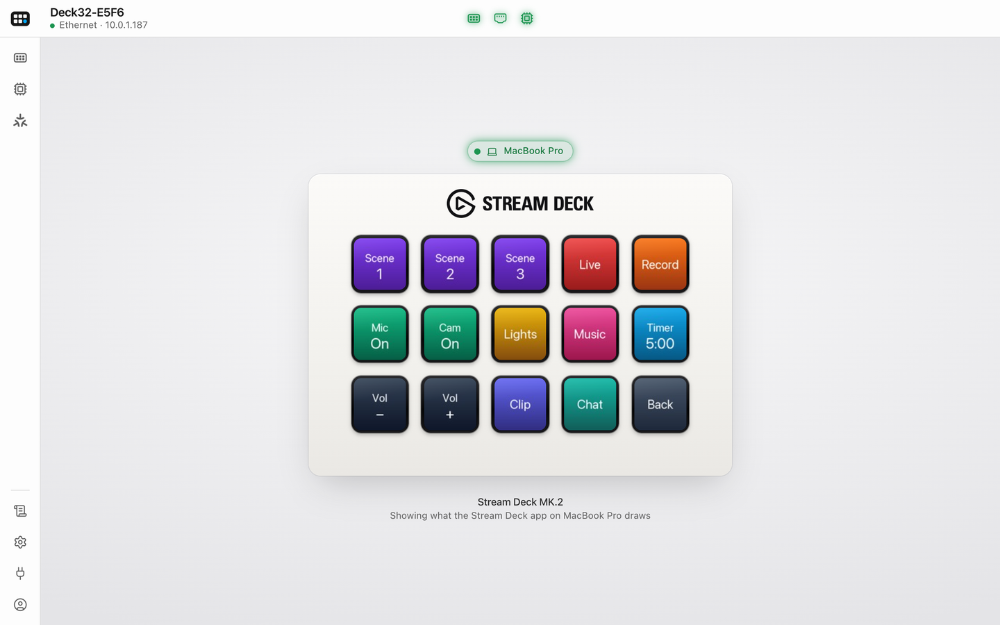
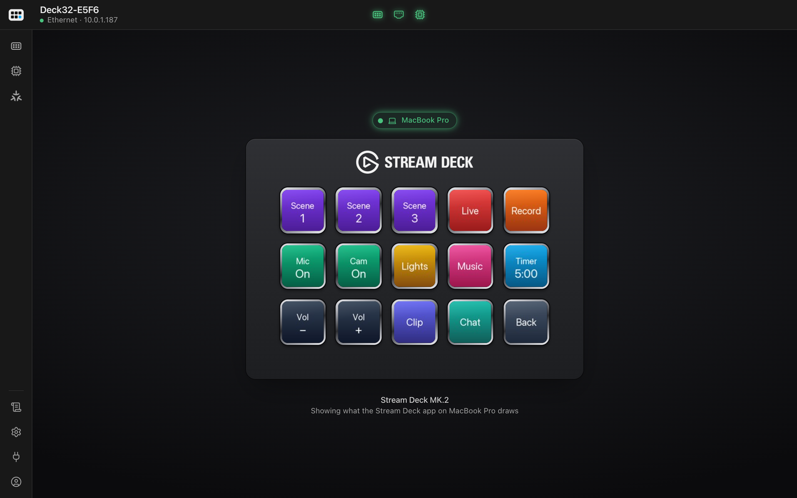
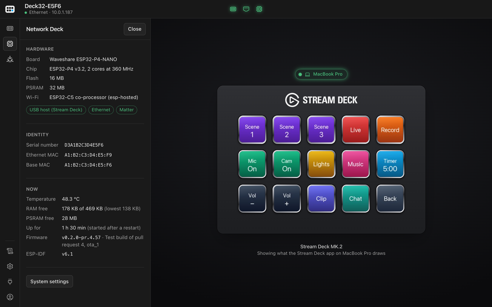
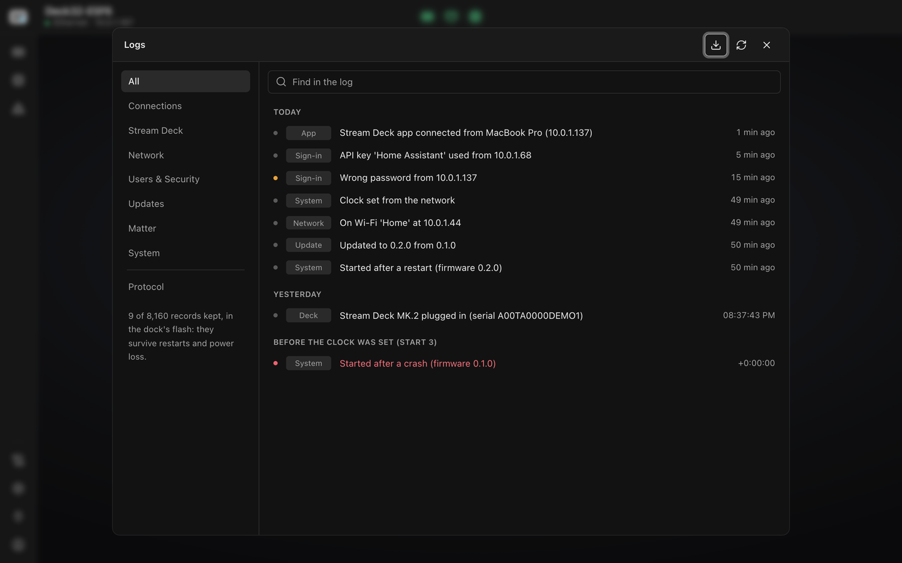
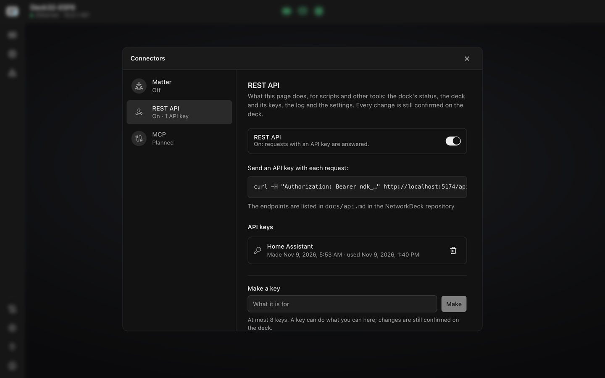
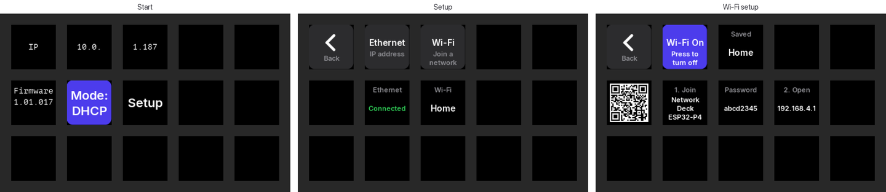

# NetworkDeck

A Stream Deck Network Dock on a Waveshare ESP32-P4-NANO (PoE). Plug a Stream Deck into the board's
USB-A port; the official Stream Deck app adds it with "Add Network Device…" and drives it over the
network, so your profiles and plugins run unchanged — no laptop next to the deck.



- **Works with:** the Stream Deck app (macOS, tested with 7.6), Bitfocus Companion and anything built
  on `@elgato-stream-deck/tcp`. Decks: Stream Deck MK.2 (tested); the Mini's screens are in place.
- **Network:** Ethernet with PoE, Wi-Fi when there's no cable, and a setup hotspot (QR code on the
  deck) when there's nothing to join.
- **On the deck** while no app is connected: IP address, network, firmware, DHCP/static, an on-deck
  static IP editor, and confirmations for changes made in the web interface.
- **Web interface** at the dock's address, behind a password or passkeys: the deck live in the middle
  (what the app draws on each key, and which key is pressed) with the computer the app runs on,
  lights for the deck, the network and the dock's health in the top bar, the deck's and the dock's
  details, a log, and the settings (system, network, Wi-Fi, users, appearance, firmware updates with
  automatic rollback).
- **REST API** with API keys (Connectors → REST API), described in [docs/api.md](docs/api.md).
- **Matter:** add the dock to Home Assistant, Apple Home or Google Home and every key is a button
  there (press, release, long press), for automations — also while the Stream Deck app drives the
  deck.

| | |
|---|---|
|  |  |
|  |  |

The dock's own screens on the deck, while no app is connected:



## HTTPS and passkeys

The dock serves its interface over HTTP and over HTTPS. For HTTPS it is its own certificate
authority, made on first start and limited (name-constrained) to the dock's own names and private
addresses. Download it from **Settings → Users** (or `/ca.pem`), trust it once — on a Mac, open it and
set it to Always Trust in Keychain Access — and `https://<name>.local` gets a padlock. There, Settings →
Users adds passkeys (Touch ID, Face ID, a phone, a security key) to sign in without the password.
Renaming the dock makes a new authority, to trust again.

## Matter

Matter is off until you turn it on: open **Connectors → Matter** in the web interface (or the
Matter panel in the rail), choose **Set up Matter**, and scan the QR code (in Home Assistant: **Add Matter device**
in the companion app), or type the setup code. Each dock has its own random code. The dock is
uncertified — it uses the Matter SDK's test attestation — so the app asks before adding it; with
Google Home that needs a developer project for vendor `0xFFF1` / product `0x8000`.

While the dock has no controller, pairing opens for 15 minutes at every start. **Open pairing** opens
it again, also to add a second controller (say, Home Assistant next to Apple Home). The keys are endpoints 1 to
15 on a Stream Deck MK.2, numbered from the top-left key the way you read.

## Install

Download `networkdeck-esp32p4-v<version>-full.bin` (or `networkdeck-esp32c6-v…` for an ESP32-C6 board) from the [latest release](../../releases/latest) and write it at
offset 0 over the board's Type-C port:

```sh
python -m esptool --chip esp32p4 -p /dev/cu.usbmodem<…> -b 460800 write-flash 0x0 networkdeck-esp32p4-v<version>-full.bin
```

Later updates: drop `networkdeck-<chip>-v<version>.bin` (without `-full`) on Settings → Firmware in the web interface.

## API

Everything the web interface does is a small REST API, for scripts and other tools: make an API key in
Settings → API keys and send it as `Authorization: Bearer …`. The endpoints are in [docs/api.md](docs/api.md).

## Build

ESP-IDF v6.1. From `firmware/`: `idf.py build flash monitor`. The first configure downloads
esp-matter 1.6.1 (10 MB, checked against a pinned SHA-256) into `firmware/third_party/` and patches it
to share the network with the rest of the firmware: see `firmware/cmake/esp_matter.cmake`. Host tests (protocol core, HID parser,
deck screens) run on the Mac or Linux:

```sh
cmake -S firmware/test/host -B build/host -G Ninja && cmake --build build/host && build/host/deck32_tests
```

`tools/dock-client` is a test host built on `@elgato-stream-deck/tcp` (discover, read the dock,
draw, read keys, benchmark).

Other chips: the ESP32-C6 builds with its own configuration and build folder (Wi-Fi and the web
interface; no Stream Deck, the C6 has no USB host):

```sh
idf.py -B build-c6 -DIDF_TARGET=esp32c6 -DSDKCONFIG=sdkconfig.c6 build flash monitor
```

Chip-specific settings are in `firmware/sdkconfig.defaults.<chip>`.

## Development

Pull requests go into `develop`; merging `develop` into `main` releases when `VERSION` was raised
(see `.github/workflows/firmware.yml` and `CHANGELOG.md`). CI runs on the self-hosted runner in the k3s
cluster (`deploy/ci-runner/`: `sh deploy/ci-runner/setup.sh` creates or updates it).

The web interface lives in `console/` (Vue): `npm run build:firmware` writes the gzipped page the
firmware embeds; `ND_DEVICE=http://<ip> npm run dev` serves it with the API proxied to a dock.

The USB host driver carries one fix for the
P4's high-speed interrupt endpoints: `firmware/vendor/usb/DECK32_PATCH.md`.
